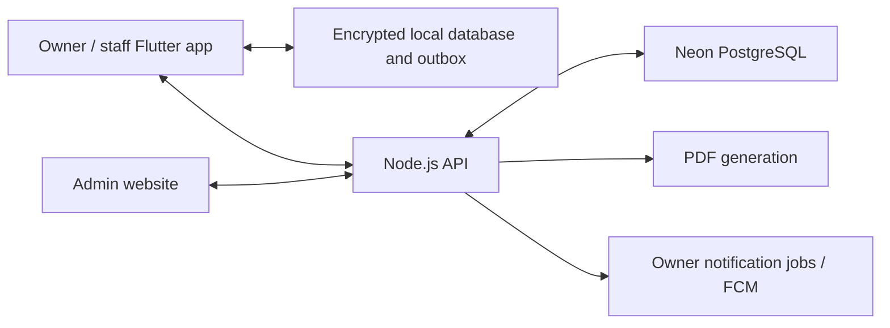

# BillEase

An offline-capable Android billing and delivery application for small businesses, built with Flutter, Node.js and PostgreSQL.

**Portfolio showcase. The complete application source is private. A technical walkthrough or selected code samples can be shared on request.**

## The problem

Small businesses need consistent billing, delivery and customer balances when multiple people work across phones and connectivity is unreliable. BillEase stores work locally, synchronizes with a central API, and gives owners control over staff approvals and financial changes.

## Features

- Owner and staff Android workflows, plus a separate browser administrator website.
- Bills, quotations, partial deliveries, returns, debt, repayments and customer advances.
- Composition Bills of Supply and supported regular GST invoices using inclusive prices and frozen issuance snapshots.
- Encrypted local SQLite, incremental catalogue synchronization and a durable operation outbox.
- Explicit conflict handling, owner approvals, device revocation and authenticator MFA with recovery codes.
- PDF documents and operational reports.

## Technology

| Layer | Tools |
| --- | --- |
| Mobile | Flutter, Dart, Drift / encrypted SQLite |
| API | Node.js 24, Express |
| Database | PostgreSQL on Neon |
| Hosting | Docker on Render |
| Notifications | Firebase Cloud Messaging integration |
| Documents | PDFKit with embedded fonts |

## Architecture

## Engineering decisions

- Integer paise and exact unit conversions support consistent financial calculations.
- Stable operation identifiers allow retries without duplicating accepted work.
- Historical price, tax and legal snapshots preserve issued documents after catalogue edits.
- Business membership and device checks enforce role-specific data access.
- Returns reduce debt first; excess is wholly refunded or wholly retained as advance.
- Development and production have separate credentials and data environments.

## Development status

The project has a development implementation and a hosted development service. Automated backend and Flutter regression checks have been run during development; those checks do not establish production or physical-device acceptance. Physical-device acceptance, production signing/operations and live notification delivery remain release checks. Government e-invoicing is outside scope.

The next requested customer-picker and decimal-display redesign remains pending. This repository deliberately contains documentation only. It does not provide production credentials, real customer data, application source or administrator access.

## Walkthrough

A useful interview walkthrough covers business setup, catalogue/customer entry, billing, an offline sync retry, staff approval, delivery, return settlement and PDF output. Screenshots and a recorded demo can be added using fictional business and customer data. No live administrative credentials are published.
