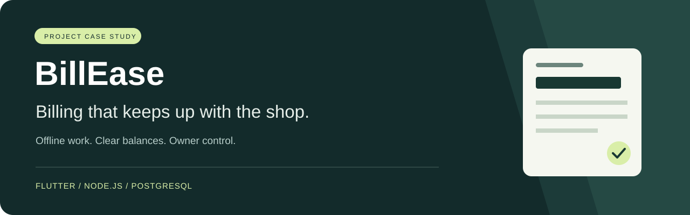
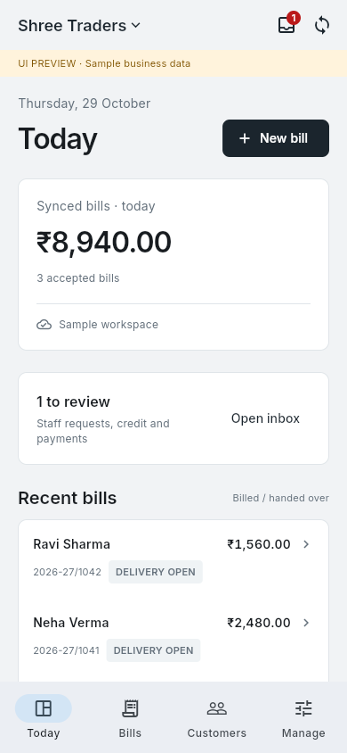
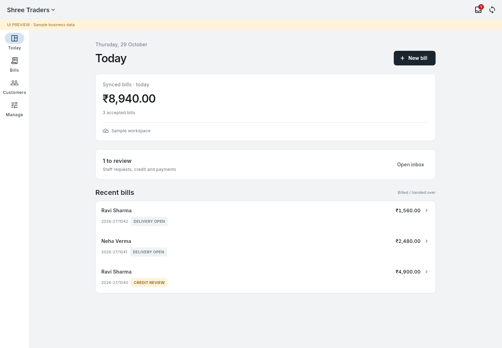
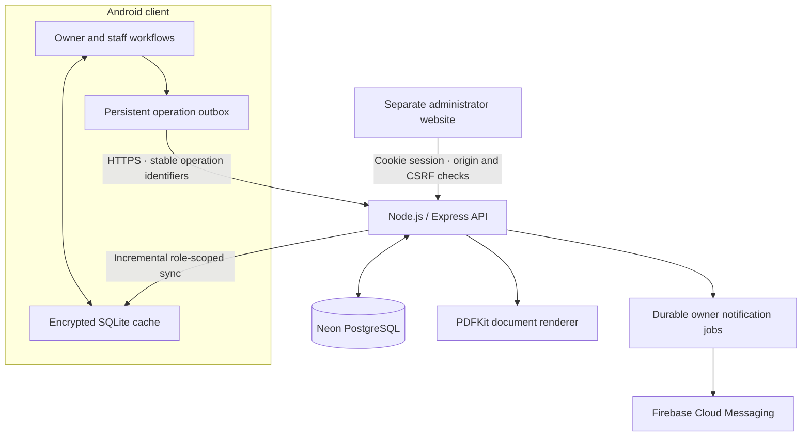

  

  <strong>An offline-capable billing and delivery system for small businesses.</strong> 
  Built around the difficult parts: interrupted connectivity, partial deliveries, customer balances, and accountable approvals.

  <a href="#product-preview">Product preview</a> ·
  <a href="#engineering-highlights">Engineering highlights</a> ·
  <a href="docs/ENGINEERING.md">Technical case study</a> ·
  <a href="#why-the-source-is-private">Why private?</a>

---

## At a glance

| Product | Engineering | Delivery |
| --- | --- | --- |
| Owner and staff Android app | Encrypted local storage and reliable retries | Flutter / Dart |
| Separate administrator website | Business-scoped access and device sessions | Node.js / Express |
| Billing, deliveries and customer accounts | Exact financial arithmetic and preserved history | PostgreSQL / Neon |
| PDF documents and operational reports | Incremental sync and explicit conflict handling | Docker / Render |

**Source availability:** private application repository; public product and engineering showcase.

## Why I built BillEase

A sale does not end when an invoice is created. A customer may pay partly, collect goods in several visits, return a portion, or leave excess money as an advance. Meanwhile, staff and owners may be recording work on different phones with unreliable connectivity.

BillEase brings those connected workflows into one system: record work on the phone, synchronize it safely, preserve the financial trail, and put owner decisions where they belong.

The project covers the Android client, API, relational data model, separate administrator interface, document generation, and development deployment.

## Product preview

These are **existing screenshots of the Flutter browser UI preview**, captured with fictional sample data. They show the interface across screen sizes; they are not screenshots of live customer accounts or proof of native-device acceptance. The preview banner is intentionally retained.

<table>
  <tr>
    <td width="32%" align="center"><strong>Owner workspace · mobile layout</strong></td>
    <td width="68%" align="center"><strong>Responsive workspace · larger layout</strong></td>
  </tr>
  <tr>
    <td valign="top"></td>
    <td valign="top"></td>
  </tr>
</table>

The workspace makes the day's accepted bills, pending decisions, and outstanding deliveries visible together. The wide screenshot is the Flutter preview, not the separate administrator website.

## What the product handles

| Workflow | Behavior |
| --- | --- |
| **Billing and quotations** | Item/unit selection, inclusive prices, server-assigned invoice numbers, and quotations that do not change balances. |
| **Partial deliveries** | Track billed, handed-over and remaining quantities across multiple collection events. |
| **Customer accounts** | Opening debts, repayments, advances and explicit corrections with an explainable ledger. |
| **Returns and cancellation** | Use original bill values; reduce debt first, then refund the whole remainder or retain it wholly as advance. |
| **Owner decisions** | Staff credit/payment claims and supported adjustment requests go through owner review. |
| **Offline work** | Save operations locally, retry original intentions, and retain conflicts for deliberate resolution. |
| **Documents and reports** | Generate PDFs from saved issuance snapshots and view operational financial/fulfilment reports. |
| **Administration** | Set up businesses, accounts, memberships and device access through a separate website. |

## Engineering highlights

### 1. A network timeout must not create a second payment

An operation is saved before upload and retried with the same identifier and payload. The backend retains accepted results for idempotent replay. Conflicting financial work is surfaced for resolution rather than merged using phone timestamps.

### 2. A new catalogue price must not rewrite an old invoice

Incremental sync updates the actual local catalogue and unit rows. Issued documents retain their original price, conversion, tax and legal snapshots, so later catalogue changes do not silently alter historical bills.

### 3. Financial precision is part of the data model

Money is represented in integer paise. Conversion factors use exact decimal representations, and cumulative return allocations are bounded by original values. A customer balance is supported by ledger events rather than only a mutable total.

### 4. Permissions extend beyond hiding buttons

API checks include business membership, role, active device and session state. Staff synchronization receives restricted projections. Administrator status grants setup access; it does not automatically grant business financial access.

### 5. Offline access still has a boundary

The phone uses encrypted SQLite and protected token/key storage. Offline authorization is time-bounded; revoked-device retained work has a signed upload and owner-review path.

[Read the technical case study →](docs/ENGINEERING.md)

## System architecture

| Layer | Main technologies |
| --- | --- |
| Mobile interface | Flutter, Dart |
| Local persistence | Drift, encrypted SQLite, secure key/token storage |
| Backend | Node.js 24, Express, modular routes/services/utilities |
| Authoritative storage | PostgreSQL on Neon, transactions and ordered migrations |
| Documents | PDFKit and embedded fonts |
| Notifications | Firebase Cloud Messaging integration |
| Development hosting | Docker on Render; separate application/database environments |

## Quality and development status

Recorded verification for the **1 November 2026 owner-billing fix** included **62 backend tests across 35 files**, **13 focused Flutter tests**, clean targeted Dart analysis, and a signed development APK build. These are dated development results, not a claim of current production certification or a measure of adoption.

The application has a development implementation and a hosted development service. Physical-device acceptance, live owner notification delivery, production signing and operational readiness remain release checks. The next customer-picker and decimal-display redesign is pending.

Supported GST workflows include composition Bills of Supply and supported regular GST invoices. Operational adjustment reports are not government filing documents. Government e-invoicing is outside this project's agreed scope.

## Why the source is private

BillEase is intended for practical business use and contains business-specific billing, settlement and approval workflows. I keep the complete implementation private to **protect that application logic and intellectual property, control redistribution, and review source access deliberately**.

This public repository provides the product story, interface previews, architecture, and implementation decisions needed to discuss the work professionally. A code walkthrough or selected source samples can be considered on request.

Private source is a distribution choice, not a substitute for secure engineering. Credentials, private signing material and real customer records are excluded from both repositories.

## Discuss the project

An interview walkthrough can follow one complete journey:

**Business setup → catalogue and customer → bill → offline retry → owner decision → partial delivery → return settlement → PDF.**

Useful technical discussion topics include idempotency, transaction boundaries, encrypted offline persistence, role-scoped synchronization, exact money arithmetic, and reproducible financial documents.

Contact: [Aman on GitHub](https://github.com/Ever-Aman).

---

Public documentation and sample-data previews. Application source remains private. No administrative credentials or live customer data are published here.
